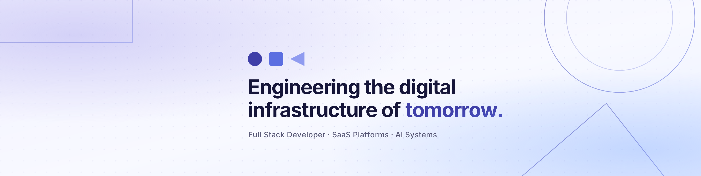

## Hi there 👋, I'm Rafiul Islam Refat
> ### Web Application Developer

I’m a full-stack web application developer working with the MERN stack, and I love turning ideas into fast, clean, user-friendly products. Over the years, I’ve delivered almost a hundred projects for clients, and I’ve learned that great results come from clear communication as much as good code. I mostly build with React, Next.js, Node.js, JavaScript, and Python, and I like starting each project by understanding the goal, so the final product solves a real problem instead of just looking good.

I’m always learning, and these days I’m exploring modern AI technologies, from AI-assisted development to building smarter features into web apps. I enjoy sharing what I pick up along the way and keeping up with where the industry is heading.

 

- 👀 &nbsp; I’m interested in **MERN Stack Development** & **Python Programming**.
- 💼 &nbsp; I’m **good** in **Web Application Development** with React Js & Next JS💪.
- 🤖 &nbsp; Exploring AI Integration, LLM-powered applications, AI Agents & Intelligent Automation to build smarter solutions.
- 👯 &nbsp; Open to discuss & let's build something amazing together! 🚀
- 📫 &nbsp; Email me: rirefat.official@gmail.com 
- 👨‍💻 &nbsp; All of my projects are available at my [portfolio](https://rafiulrefat.vercel.app/)
- ☕ &nbsp; I believe a perfect cup of coffee can be the ultimate solution for stress. 
<be>

## Connect with me: 🏃

  
      
      
      
   
      
      
       
      

<!--              -->
<be>

<h2 align="center">🚀 Technologies & Tools</h2>

<h3 align="center">💻 Programming Languages</h3>

  
  
  
  
  
  

<h3 align="center">⚡ Frontend Development</h3>

  
  
  
  
  
  

<h3 align="center">🛠️ Backend & Database</h3>

  
  
  
  
  

<h3 align="center">🤖 AI & LLM Technologies</h3>

  
  
  
  
  

<h3 align="center">🔄 AI Automation & AI Coding Tools</h3>

  
  
  
  
  

<h3 align="center">🔧 Tools & Platforms</h3>

  
  
  
  
  

  

